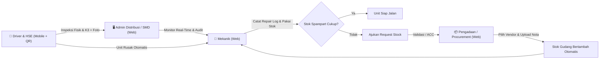

<p align="center">
  
</p>

<h1 align="center">TOYACHECK</h1>

<p align="center">
  <strong>Sistem Monitoring dan Digitalisasi Operasional Armada Distribusi Berbasis Web &amp; Mobile</strong><br>
  <em>Integrated Fleet Inspection, Maintenance, Sparepart Inventory &amp; Procurement System — PT. Toyamilindo (MOUNTOYA)</em>
</p>

<p align="center">
  
  
  
  
  
</p>

---

## 📖 Tentang Proyek

**TOYACHECK** adalah aplikasi terintegrasi berbasis **Web Desktop** dan **Mobile Web (QR-Enabled)** yang dirancang untuk mendigitalisasi seluruh siklus operasional armada distribusi Air Minum Dalam Kemasan (AMDK). Sistem ini menggantikan pencatatan checklist kertas, pelaporan kerusakan armada, pemantauan bengkel mekanik, hingga pengajuan dan pembelian suku cadang menjadi satu alur kerja *real-time* yang saling terhubung antar departemen.

### 🎯 Masalah yang Diselesaikan
* **Inspeksi Harian Terstandarisasi:** Menghilangkan risiko formulir fisik tercecer dengan checklist digital berbasis *database* (Fisik &amp; K3) beserta dokumentasi foto kendala.
* **Otomatisasi Status Armada:** Temuan kerusakan pada saat inspeksi langsung mengubah status kendaraan menjadi **Rusak** dan meneruskannya ke dashboard pemantauan **Admin Distribusi** serta antrean kerja **Mekanik**.
* **Kontrol Stok &amp; Pengadaan Transparan:** Menghubungkan pemakaian suku cadang di bengkel, sistem kategorisasi ABC, pengajuan *request stock*, verifikasi, pemilihan vendor berlokasi peta, hingga pencatatan nota pembelanjaan yang otomatis memperbarui stok gudang.

---

## 🔄 Alur Proses Bisnis Terintegrasi



---

## 👥 Aktor & Fitur Utama (5 Role Internal + Vendor)

### 1. 📱 Driver *(Mobile Web &amp; QR Code Entry)*
* **Akses QR Code Armada (`/m/qr/{code}`):** Pindai QR Code yang tertempel pada unit truk/garasi untuk langsung menuju layar login mobile.
* **Pemilihan &amp; Detail Armada:** Pencarian unit kendaraan, informasi servis berkala, serta riwayat sopir terdahulu.
* **Checklist Fisik (*Pre-Trip Inspection*):** Pemeriksaan mesin, ban, rem, kelistrikan, dan bodi dengan input *Check Keadaan* (Aman/Kendala) serta unggah foto bukti temuan kerusakan.

### 2. 🦺 HSE / K3 *(Mobile Web)*
* **Inspeksi K3 &amp; Kebersihan Pengiriman:** Pemeriksaan standar kebersihan bak, keamanan muatan, dan kelayakan pengiriman produk jadi.
* **Manajemen Parameter K3 (`/driver/k3-items`):** Menambah, mengedit, dan menonaktifkan item kriteria K3 secara dinamis tanpa mengubah kode.
* **Kelola Laporan K3:** Edit atau hapus laporan K3 dan cetak PDF riwayat kendaraan.

### 3. 📊 Admin Distribusi / SMD *(Web Desktop)*
* **Dashboard Monitoring *Real-Time*:** 4 kartu KPI utama (*Total Checklist, Armada Sehat, Tidak Layak Jalan, Sedang Diperbaiki*), widget kendala Fisik &amp; K3, serta tabel inspeksi terbaru dengan filter tanggal.
* **Data Master Terpusat:**
  * **Pengguna (`/users`):** CRUD akun, NIK karyawan, role Spatie, dan foto profil (avatar).
  * **Armada (`/vehicles`):** CRUD unit truk, dimensi box, tahun STNK &amp; KIR, serta halaman **Cetak Stiker QR Code Armada** (`/vehicles/qr/print`).
  * **Item Pemeriksaan (`/inspection-items`):** Master parameter checklist Fisik &amp; K3 berbasis database.
* **Audit &amp; Pelaporan (`/riwayat`):** Edit hasil checklist, **Export CSV**, dan **Cetak PDF 2 Lembar (A4 Landscape)** matriks harian tanggal `1–31` per armada (Lembar Fisik &amp; Lembar K3 `MOUNTOYA DSB-F-02-01`).
* **Monitoring Perbaikan &amp; Pengajuan:** Pantau catatan perbaikan mekanik (`/maintenances`), direktori vendor (`/vendors`), serta review permintaan suku cadang (`/sparepart-requests`).

### 4. 🔧 Mekanik *(Web Desktop)*
* **Dashboard &amp; Tren Perbaikan:** Rekap stok suku cadang kategori **ABC**, peringatan stok kritis, rekap perbaikan armada, dan grafik **Tren Perbaikan Teratas** berdasarkan data aktual.
* **Repair Log (`/mekanik/repairs`):** Catat kerusakan, tindakan solusi, estimasi *downtime*, serta pemilihan multi-sparepart yang otomatis memotong stok gudang dan menyinkronkan status armada (*Maintenance / Siap Jalan*). Mendukung **Export PDF**.
* **Inventaris &amp; Master Data (`/mekanik/inventory`, `/mekanik/master-data`):** Kelola daftar *Spare Part*, *Tool Kit*, dan *Support* lengkap dengan lokasi penyimpanan.
* **Request Stock (`/mekanik/inventory/request`) &amp; Persetujuan (`/mekanik/approvals`):** Pengajuan kebutuhan sparepart ke Pengadaan lengkap dengan tingkat prioritas dan export CSV histori pembelanjaan.

### 5. 📦 Pengadaan / Procurement *(Web Desktop)*
* **Dashboard Ringkasan Pengadaan:** Statistik permintaan (*Kritis vs Normal*), alert **Stok Kritis**, jumlah **Vendor Aktif**, notifikasi pengajuan masuk, riwayat pembelanjaan terbaru, serta perbandingan **Performa Vendor**.
* **Master-Detail Permintaan (`/pengadaan/requests`):** Tampilan 2 kolom daftar permintaan &amp; panel eksekusi (`✓ Diterima` / `⊘ Ditolak`), timeline persetujuan, serta stepper 3 tahap pengadaan.
* **Lokasi Vendor &amp; Map Logistik (`/pengadaan/vendors`):** Direktori pemasok dengan kategori spesialisasi, peta interaktif **Leaflet OpenStreetMap**, dan form pendaftaran vendor dengan pin koordinat *Latitude/Longitude*.
* **Laporan &amp; Input Nota (`/pengadaan/reports`):** Tabel riwayat belanja dengan pratinjau foto bukti transfer, filter kalender rentang tanggal, form **Detail Transaksi Baru** multi-baris (`+ TAMBAH BARIS`) dengan *drag &amp; drop* bukti transfer (otomatis menambah stok katalog), serta **Download PDF**.
* **Persetujuan (`/pengadaan/approvals`):** Daftar riwayat pengadaan berstatus Disetujui lengkap dengan filter tanggal dan cetak PDF.

---

## 🛠️ Tech Stack

| Kategori | Teknologi / Pustaka |
| :--- | :--- |
| **Backend Framework** | Laravel `^13.17` (PHP `^8.3`) |
| **Access Control (RBAC)** | `spatie/laravel-permission` `^8.3` |
| **PDF &amp; Export** | `barryvdh/laravel-dompdf` `^3.1`, `maatwebsite/excel` `^4.0` |
| **Frontend &amp; Styling** | Blade Templates, Custom Design System CSS, Vite `^8.0`, Tailwind CSS `^4.0` |
| **Maps &amp; Icons** | Leaflet.js (OpenStreetMap), Font Awesome 6 |
| **Database** | MySQL / MariaDB |
| **Testing &amp; Code Style** | PHPUnit `^12.5`, Laravel Pint `^1.27` |

---

## 🗄️ Struktur Modul Database

Aplikasi ini dibangun di atas struktur tabel relasional yang terintegrasi:
* **Auth &amp; Preferensi:** `users` (termasuk `employee_id`, `avatar`, `assigned_vehicle_id`), `user_settings`, serta tabel Spatie (`roles`, `permissions`, `model_has_roles`).
* **Armada &amp; Inspeksi:** `vehicles`, `inspection_items` (hierarki `parent_id` &amp; kategori `fisik`/`k3`), `checklists`, `checklist_items` (menyimpan keputusan &amp; `foto_dokumentasi`).
* **Bengkel &amp; Inventaris:** `spareparts` (stok, minimal stok, kategori ABC, tipe `sparepart`/`toolkit`/`support`), `maintenances`, `maintenance_details`.
* **Pengadaan &amp; Vendor:** `vendors` (spesialisasi, alamat, koordinat peta), `sparepart_requests`, `purchases`, `purchase_items`.

---

## 🚀 Panduan Instalasi Lokal

Pastikan di lingkungan lokal Anda sudah terpasang **PHP >= 8.3**, **Composer**, **Node.js &amp; NPM**, serta **MySQL** (misalnya melalui Laragon atau XAMPP).

1. **Clone Repository**
   ```bash
   git clone https://github.com/username/TOYACHECK.git
   cd TOYACHECK
   ```

2. **Install Dependensi Backend &amp; Frontend**
   ```bash
   composer install
   npm install
   ```

3. **Konfigurasi Environment (`.env`)**
   ```bash
   cp .env.example .env
   php artisan key:generate
   ```
   Sesuaikan konfigurasi database di file `.env`:
   ```env
   DB_CONNECTION=mysql
   DB_HOST=127.0.0.1
   DB_PORT=3306
   DB_DATABASE=toyacheck
   DB_USERNAME=root
   DB_PASSWORD=
   ```

4. **Migrasi Database &amp; Seeding Data Awal**
   ```bash
   php artisan migrate --seed
   ```
   *(Perintah ini menjalankan `RoleSeeder`, `AdminSeeder`, `VehicleSeeder`, `InspectionItemSeeder`, `SparepartSeeder`, `VendorSeeder`, dan `PurchaseSeeder` secara otomatis).*

5. **Tautkan Storage Publik (untuk Foto Avatar, Dokumentasi Checklist, &amp; Bukti Transfer)**
   ```bash
   php artisan storage:link
   ```

6. **Build Aset &amp; Jalankan Server**
   ```bash
   npm run build
   php artisan serve
   ```
   Akses aplikasi di browser melalui `http://127.0.0.1:8000` (atau virtual host Laragon seperti `http://toyacheck.test`).

---

## 🔐 Akun Demo (Hasil Seeder)

Gunakan akun bawaan dari `AdminSeeder` berikut untuk mencoba seluruh alur masing-masing role:

| Role | Username | NIK (`employee_id`) | Password | Tampilan Platform |
| :--- | :--- | :--- | :--- | :--- |
| **Admin Distribusi (SMD)** | `distributor2` | `EMP-0001` | `Admin123!` | Web Desktop |
| **Driver** | `driver1` | `EMP-0002` | `Driver123!` | Mobile Web (`/driver`) |
| **HSE / K3** | `hse1` | `EMP-0003` | `Hse123!` | Mobile Web (`/driver`) |
| **Mekanik** | `mekanik1` | `EMP-0004` | `Mekanik123!` | Web Desktop (`/mekanik/...`) |
| **Pengadaan** | `pengadaan1` | `EMP-0005` | `Pengadaan123!` | Web Desktop (`/pengadaan/...`) |

---

## 📂 Struktur Direktori Penting

```text
TOYACHECK/
├── app/
│   ├── Http/Controllers/
│   │   ├── AuthController.php             # Autentikasi Web Desktop
│   │   ├── DashboardController.php        # Dashboard terpadu (Admin, Mekanik, Pengadaan)
│   │   ├── DriverAppController.php        # Alur Mobile Driver, HSE, & QR Code
│   │   ├── MekanikController.php          # Modul Bengkel, Inventaris ABC, & Repair Log
│   │   ├── PengadaanController.php        # Modul Procurement, Vendor Map, & Nota Belanja
│   │   ├── VehicleController.php          # Master Data Armada
│   │   ├── ChecklistController.php        # Inspeksi & Evaluasi Armada
│   │   ├── ChecklistHistoryController.php # Rekap Riwayat & Cetak PDF 2 Lembar
│   │   └── ...
│   └── Models/                            # Eloquent Models (Vehicle, Checklist, Purchase, dll.)
├── database/
│   ├── migrations/                        # Skema tabel lengkap
│   └── seeders/                           # Data awal role, user, armada, vendor, dll.
├── resources/views/
│   ├── layouts/                           # Layout utama & Sidebar berbasis Role
│   ├── driver/                            # Antarmuka Mobile Driver & HSE
│   ├── mekanik/                           # Antarmuka Web Mekanik
│   ├── pengadaan/                         # Antarmuka Web Pengadaan
│   └── ...                                # Views Admin Distribusi (vehicles, users, riwayat, dll.)
└── routes/web.php                         # Definisi route dengan guard Spatie Role
```

---

## 🧪 Pengujian

Jalankan unit &amp; feature test bawaan menggunakan perintah:
```bash
php artisan test
```

---

<p align="center">
  Dibuat untuk digitalisasi operasional armada distribusi <strong>TOYACHECK</strong>.
</p>
